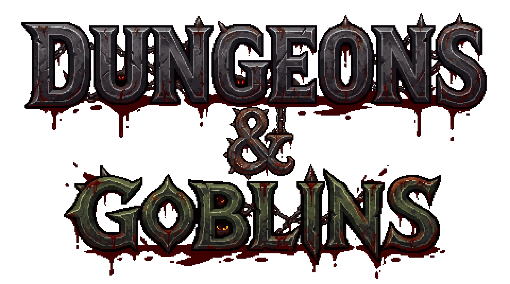

<p align="center"></p>

# Dungeons & Goblins

A top-down dungeon crawler in TypeScript, Pixi.js v8 and Miniplex, adapted from Catacomb Snatch Redux.
Fight through a procedurally generated dungeon (sword, spells and arrows), loot coins and gear, and take
the exit down to the next level — alone, or with up to three friends in peer-to-peer co-op.

## Running it locally

You need [Node.js](https://nodejs.org/) 20 or newer.

```bash
npm install      # once
npm run dev      # starts the dev server; open the address it prints (http://localhost:5173 by default)
```

Other commands:

| Command | What it does |
|---|---|
| `npm run build` | Production build into `dist/` |
| `npm run preview` | Serves the production build locally |
| `npm run check` | Type check, style rules, rules-file sync and the gameplay tests (run before committing) |
| `npm test` | Just the gameplay tests (`tests/gameplay.test.mjs`) |

### Releasing

Pushing a version tag publishes the game: `git tag v1.2.0 && git push origin v1.2.0` runs
[`.github/workflows/deploy.yml`](.github/workflows/deploy.yml), which checks and builds it (served from
`/dungeons-and-goblins/`, set by `VITE_BASE_URL`), deploys it to GitHub Pages and makes a GitHub release for the
tag with generated notes. In the repository's Settings → Pages, the source must be "GitHub Actions".

Controls: WASD to move, the mouse to aim, left click (or Space) to attack, G to swap the 1st and 2nd weapon,
Q R T 1–5 X C to cast the quick bar's squares (with Shift: its second row, the class features at first; holding
Shift shows that row), right click / F to cast the square last picked (or clicked), E to use (shop, chests, the
exit, the lever, a stash), Shift to sprint, Tab for the inventory, ~ for the console, Esc to pause. Keys can be
rebound in Settings → Key bindings. What E would use is framed by white corner brackets.

Every game starts with typing your name and picking a hero — a **Fighter**, **Wizard**, **Rogue**, **Warlock**, **Bard**, **Fighter 2** or **Cleric**; heroes
are named after their class, the player names the character
(see `classes.json` below) — then the intro plays (`public/intro-video.mp4` under the story; E, Enter or a
click skip it) and the first level fades in. The safe room starts closed: pull the lever by its door (E) to
raise the portcullis. In co-op the lever waits until every player has loaded the level, and every other player
must agree to it (Agree / Refuse at the top of their screen); only one pull at a time, and the lever rests a
moment after each. Once the gate is open the party has **10 seconds** to leave the safe room — whoever is still
inside when it shuts dies.

In co-op every player picks their hero in the lobby (a guest too, whoever joins by the invite link): the names of
the players who took a hero show over its portrait, and two players may play the same hero.

On screen: the health bar bottom left, with four round buttons over it — character and level (placeholder
dialogs for now), the map, which shows the explored dungeon with holes and treasure marked (Esc or ✕ closes a
dialog), and rest (the moon: a short or a long rest, see below); the quick bar of the hero's spells bottom
middle (each square shows its spell's effect, shaded while it recovers; hover for what it does); the combat log
bottom right (scroll it with the mouse wheel or its scrollbar; the `–` in its corner folds it away, `+` brings it
back).

The inventory is titled with the hero's name; its sheet shows their level and experience ("XP 450/900") and
their hit dice ("Hit dice 1/2 d6": left of one a level) — click them to spend one and heal (the die + CON).
Right-click an item for its menu: **Send to** another player puts it in the first free square of their bag.

### Coins and finds

- Nothing is thrown on the floor any more: a kill's coins go straight into the purse of whoever struck last, a
  chest's to whoever opened it, and the sum shows over their head and in the combat log ("Evincars +12 gold").
- Some urns, closed coffins, bowls, sacks and jars hide a few coins: E (or a click) on one finds them, once.
- Chests always hold a piece of gear, and now and then (one kill in twelve) an enemy drops one. In co-op a
  **rare** find (+2 or better) is rolled for: it shows at the bottom of every screen (hover it for its stats) with
  **Need** and **Pass** for 30 seconds. Everyone on Need rolls a d20, the highest wins it (a tie rolls again) and it
  goes to their bag; Pass, or no answer in time, stays out — if nobody needs it, it is gone.

### The console (~)

For testing, alone (not in co-op), as in Catacomb Snatch Redux: `/help`, `/money <amount>`, `/god [on|off]`,
`/xp <amount>`, `/additem <item id>` (any case, dashes or underscores: `/additem weapon-axe-001`) and
`/items [filter]` to look ids up. Up and down recall earlier lines, Esc closes it.

### Experience, initiative and rest (D&D rules)

- **Experience**: each kill gives its SRD monster's XP (`xp` in `stats.json`), shared equally by every hero in the game.
  Levels come at the SRD totals (300 for level 2, 900 for 3, … 355,000 for 20), each with more hit points (the
  hit die's average + CON), one more hit die and a full heal, and whatever the class's `progression` hands out at that level.
- **Initiative**: when an enemy engages, it and the hero it hunts each roll d20 + DEX ("Initiative 17" over their
  heads). The winner gets the **first strike** — its next attack rolls with advantage. A hero rolls once a fight.
- **Hit dice** are spent (click on the sheet) while no enemy is hunting you.
- **Rest** (the moon button): a short rest recovers every spell — two are allowed before a long rest, and not
  while an enemy hunts the party; a long rest needs everyone in the safe room and heals all wounds, gives back
  half the hero's hit dice and recovers spells. In co-op the others are asked to agree (Agree / Refuse at the
  top of their screen; one refusal or 20 s without an answer calls it off); how it went shows at the top.

## Configuration files (JSON)

Game data you can tune without touching code. Edit a file, save, and the dev server reloads.

### [`src/data/classes.json`](src/data/classes.json) — heroes and their classes

Every hero is a human (+1 to all six abilities, already in their scores) playing a D&D 5e (SRD) class, and is named after it: `fighter`, `wizard`, `rogue`, `warlock`, `bard`,
`cleric`, and `fighter2` for a second fighter (a second hero of a class gets a 2). Their sprites keep the old names
in `public/main-characters/<name>` (`character` below). The file has two parts.

`classes` — what a class gives every hero who plays it:

- `hitDie` — hit points start at 5 × (2 × hit die + CON modifier) and each level adds the die's average + CON,
- `armor` (`light`, `medium`, `heavy`, `shield`), `weapons` (`simple`, `martial`) and `weaponBases` (single
  weapons, e.g. a wizard's dagger) — what the class is trained in; untrained armour gives disadvantage on
  attacks, an untrained weapon loses the proficiency bonus,
- `savingThrows` — the two saves that add the proficiency bonus, and `spellcasting` — the ability spells add to
  hit and to their save DC (`null`: not a caster),
- `progression` — per level 1–20 a list of rewards: `{ "feature": id }` (`sneak_attack`,
  `jack_of_all_trades`, `disciple_of_life`, `agonizing_blast`), `{ "spell": id }` (the quick bar lists spells in the
  order learnt), `{ "asi": true }` (an Ability Score Improvement the player takes, see below), `{ "choice": "fighting_style" }` (a Champion's second one comes at level 10), `{ "choice": "archetype" }` (the Fighter's Martial Archetype, level 3),
  `{ "ability": stat, "amount": n }` or `{ "feat": id }` (`alert`, `tough`, from [`feats.json`](src/data/feats.json)). A new feature needs an id in `rules/Features.ts`, its texts and a hook where
  the rule applies; the file's `$comment` lists the SRD features not in play yet.

`heroes` — each hero's `character` (the sprite set), `class` and `abilities` (the standard array 15, 14, 13, 12,
10, 8 placed by the class's quick build, then +1 each: what a player who changes nothing keeps).

### Customising a hero (the level bubble)

The round level button of the HUD opens the hero's level log (`ui/LevelPanel.ts`, the choices are kept in
`rules/Build.ts`): a tab for every level reached, each showing what that level gave and what was chosen. A red `!`
that breathes marks the button, and the tab, while a choice is waiting:

- **Ability scores, level 1**: point buy as in the SRD (27 points, 8–15, `rules/PointBuy.ts`) plus the human's +1.
- **Fighting style, Fighter level 1** (`rules/FightingStyles.ts`): Archery (+2 to hit with ranged weapons), Defense
  (+1 AC in armour), Dueling (+2 damage with a one-handed melee weapon and no other weapon), Great Weapon Fighting
  (damage dice showing 1 or 2 are rolled again with a two-handed or versatile melee weapon held in both hands),
  Protection (a passive: with a shield, an enemy's attack on the closest ally within 5 feet is rolled with
  disadvantage, then 5 s to recover; shown top left) or Two-Weapon Fighting (a melee weapon in each hand lands
  a second attack with the one in the second hand; the style adds the ability modifier to its damage).
- Both can be changed until the hero presses **Save** (a fighter must have picked a style) or leaves the first safe
  room; then they are final (a fighter who never chose gets Defense). The chosen style stays explained on the page.
- **Martial Archetype, Fighter level 3** (`rules/Archetypes.ts`): the Champion (Improved and Superior Critical,
  Remarkable Athlete, a second fighting style at level 10, Survivor), the Battle Master (superiority dice and 16
  maneuvers, `rules/Maneuvers.ts`, picked 3 at level 3 and more at 7, 10 and 15) or the Eldritch Knight (wizard
  spells from the Player's Handbook, abjuration and evocation but for a few, `rules/KnightSpells.ts`: cantrips and
  spells picked at levels 3, 4, 7, 8, 10, 11, 13, 14, 16, 19 and 20; War Magic, Eldritch Strike, Arcane Charge). Each
  pick is final once confirmed; an archetype's features are in `features.json`, marked `needs` its id.
- **Ability Score Improvement** at the levels a class offers it (`{ "asi": true }`): +2 to one ability or +1 to two
  (none above 20), or a feat from `feats.json` instead; final once taken.

In co-op a guest's panel only asks; the host checks the request (`game/Customize.ts`).

### [`src/data/stats.json`](src/data/stats.json) — enemies

`mobs.<type>` — one entry per kind of enemy (`goblin`, `orc`, `goblin_grunt`, `goblin_rogue`,
`goblin_warrior`, `ghost_wizard`, `evil_wizard`, …), copied from the SRD monster named in `source`:

- `health` — hit points, `ac` — Armor Class, `proficiency` — proficiency bonus,
- `abilities` — the six scores,
- `weapons` — the low-end weapons it may carry (one is picked at random when it spawns),
- `xp` — the experience it is worth (SRD, by challenge rating),
- `deathPoints` — the worth of the coins its killer is paid (a nest's experience is three times it).

Speed, size and art of each enemy live next to it in `MOB_CONFIGS` in
[`src/entities/MobFactory.ts`](src/entities/MobFactory.ts).

### [`src/data/spells.json`](src/data/spells.json) — spells

D&D 5e (SRD) spells, cast with right click / R; the quick bar picks which. There are no spell slots: each spell
has a `recovery` (seconds) before it can be cast again, and a short rest recovers them all. Each has `kind` —
`bolt` (a spell attack: d20 + proficiency + casting ability against AC), `missiles` (`count` darts that always
hit), `burst` (everyone within `radius` px of the point aimed at, at most `range` px away — or of the caster
when `range` is 0 — saves on `save` against the spell DC: full damage on a failure, half on a success) or `heal`
(the caster regains the dice + casting ability) — plus `level` (0: cantrip; it sets the recovery), `damage` (dice), `damageType` and `effect`:
`[shape, colour]` from the effects library in `public/effects/` ([`src/assets/Effects.ts`](src/assets/Effects.ts)),
played where it strikes and shown on its quick-bar square, sized by `effectScale`.

### [`src/data/weapons.json`](src/data/weapons.json) — weapons

160 entries: the weapons in `public/weapons/` and the loose blades cut from `public/weapons-1.png`. Each item:

| Field | Meaning |
|---|---|
| `id` | Unique key (also used to find the item later) |
| `name` | Name shown in the inventory and tooltips (random placeholder names for now) |
| `icon` | Texture key of its picture |
| `src` | The image file under `public/` (blades from `weapons-1.png` have none: they are cut from that sheet) |
| `kind` | What it is: `axe`, `bow`, `sword`, `wand`, … |
| `base` | The D&D weapon it plays as (`dagger`, `longsword`, `longbow`, …): its damage dice, from `src/rules/WeaponTable.ts` |
| `bonus` | Magic: `0` to `3`, added to hit and to damage |
| `type` | `weapon` or `shield` |
| `gear` | Which slot it fits: `weapon` (primary or secondary hand), `offhand` (secondary hand) |
| `cost` | Price in gold |
| `weight` | Kilograms it weighs |
| `stats` | What it adds while worn: any of `strength`, `dexterity`, `constitution`, `intelligence`, `wisdom`, `charisma` (random placeholder values for now) |

### [`src/data/shields.json`](src/data/shields.json) — shields

140 shields (pictures in `public/shields/`), with the same fields as above (`gear` is `offhand`).

### [`src/data/armors.json`](src/data/armors.json) — body armour

220 suits of armour and robes (pictures in `public/armors/`), with the same fields (`gear` is `armor`;
`base` is the D&D armour — `padded` … `plate` — that sets its Armor Class, from `src/rules/ArmorTable.ts`).

### [`src/data/medals.json`](src/data/medals.json) — medals

80 medals (pictures in `public/medals/`), worn in the inventory's Medal slot, with the same fields (`gear`
is `medal`).

### Carrying

A player carries at most **100 kg** — bag and worn gear together (`MAX_CARRY_KG` in
[`src/game/PlayerActions.ts`](src/game/PlayerActions.ts)); the inventory shows the total next to the gold.
Things too heavy to carry are left lying where they are, and the shop won't sell them. Chests drop a random
weapon, shield or suit of armour (their coins go to the opener); walk over it to pick it up.

### What the stats do

A hero's ability scores are their class's plus what everything worn adds (shown on the inventory's Gear tab
with their modifiers, under them Armor Class, hit points, the weapon's damage roll and the class's
proficiencies). The modifier is what the rules use:

| Stat | Effect |
|---|---|
| Strength | Melee weapons add its modifier to hit and to damage; points on gear also lengthen a swing's reach |
| Dexterity | Ranged weapons add it to hit and damage (finesse weapons use the better of STR and DEX); it raises AC |
| Constitution | Adds to hit points each level and to every hit die spent; points on gear give +10 ticks of sprint each |
| Intelligence | A wizard's spells add it to hit and to their save DC |
| Wisdom | A cleric's spells add it; passive Perception |
| Charisma | A warlock's and bard's spells add it; points on gear: +5% coins dropped by enemies each |

### Fighting (D&D rules)

Every blow — sword, arrow, spell or an enemy's — rolls a d20 + attack bonus (proficiency + STR or DEX + magic)
against the target's Armor Class. A natural 20 always hits and doubles the damage dice; a natural 1 always
misses. A hit rolls the weapon's dice + the same modifier. The rolls show over the attacker's head for a
moment ("21 to hit", then "7 dmg" or "MISS"), and each blow goes into the combat log ("Evincars 21 to hit,
7 dmg", "Orc 12 to hit, miss"). The log also writes what else happens: rests (hit dice spent, hit points regained), healing,
kills and deaths, levels reached, and the feats, ability improvements, styles, archetypes, maneuvers and spells chosen.

**Attack speed.** Whoever attacks, a hero's swing or volley and an enemy's blow, comes once a second: spamming the key
changes nothing. Extra Attack fits its blows inside that second (2 at level 5, 3 at 11, 4 at 20), and a melee weapon in
each hand strikes with both at once on the first blow: one swing on the screen, two attacks, each rolled and dealt on its own.

### Maps as JSON

A generated level can be written out as JSON ([`src/level/LevelMap.ts`](src/level/LevelMap.ts):
`encodeLevelMap`, `decodeLevelMap`) — tiles one byte each in base64, safe rooms and cave halls as runs of
tiles, wall niches, pits, prop footprints and spawn points — and gzipped (`packLevelMap`: about 7 KB of JSON becomes about 3 KB) to
save it or send it to a client. The co-op host sends it to every guest when a level starts — terrain, decor and
the safe room's door and lever — and guests show "Loading..." until it has arrived; reading a map checks all of it.

The inventory shows each stat by its short name (STR, DEX, CON, INT, WIS, CHA); hovering it shows the full name and this description, read from `src/data/texts.json`.

Arrows have no item or count: fighting with a ranged weapon (bow, crossbow, pistol, darts — the 1st weapon, or the 2nd when the 1st hand is empty), attacking shoots.

### [`src/data/texts.json`](src/data/texts.json) — every string the player reads

Each text has a short, self-describing id (`stat.strength.name`, `menu.title.start`); code asks for it with `text(id, vars)` from [`src/core/texts.ts`](src/core/texts.ts), and `{name}` marks a value filled in at runtime. To translate, supply a file with the same ids. Key-cap names (ESC, L SHIFT) and developer logs are not in it.

## Other tuning (TypeScript)

Not JSON, but kept in one place each:

- [`src/entities/WeaponStats.ts`](src/entities/WeaponStats.ts) — sword swing, spell casting and arrow timing and reach (damage comes from the rules).
- [`src/game/Rest.ts`](src/game/Rest.ts) — short rests before a long one, how long a rest vote and its notice last.
- [`src/entities/Drops.ts`](src/entities/Drops.ts) — drop tables (what chests and kills give up, how often an enemy drops gear).
- [`src/entities/LootFactory.ts`](src/entities/LootFactory.ts) — what a kill pays, and the coins a fall scatters.
- [`src/entities/DungeonFactory.ts`](src/entities/DungeonFactory.ts) — which props may hide coins, how often and how many.
- [`src/game/LootRoll.ts`](src/game/LootRoll.ts) — what counts as rare, and how long Need / Pass stays up.
- [`src/game/Party.ts`](src/game/Party.ts) — how long a vote waits for answers; the gate's countdown is in `systems/DoorSystem.ts`.
- [`src/level/generators/DungeonConfig.ts`](src/level/generators/DungeonConfig.ts) — map size, room sizes, halls, pits, enemy density.
- [`src/level/Props.ts`](src/level/Props.ts) — every decoration and how often it appears.
- [`src/ai/constants.ts`](src/ai/constants.ts) — enemy senses, squad tactics and chase speed.

## For contributors

The project rules (code style, architecture, libraries) are in [`AGENTS.md`](AGENTS.md); `npm run check` and
`npm run build` must pass before a change is done.
